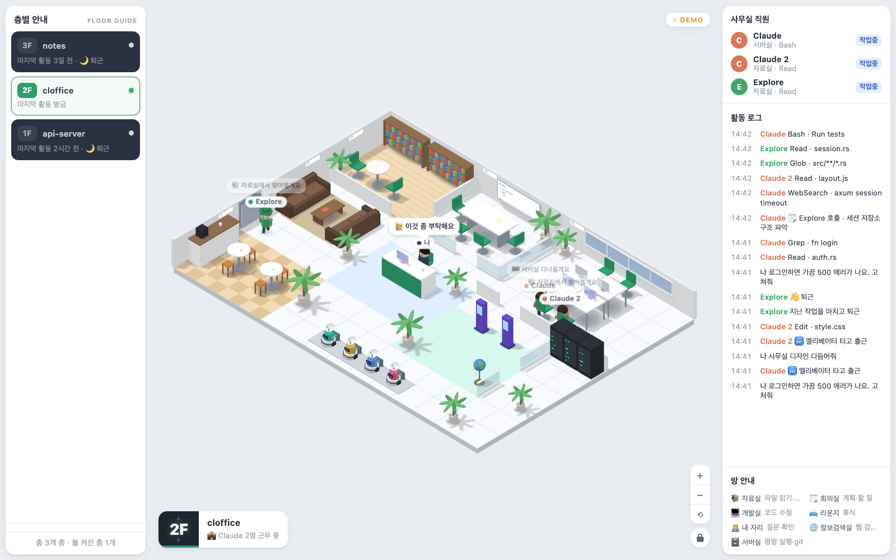

  

<h1 align="center">Cloffice</h1>

  <strong>Claude Code가 일하는 모습을 3D 사무실로 보여 주는 macOS 앱</strong> 
  A 3D office monitor for Claude Code sessions on macOS

  <a href="https://github.com/mcnorton/cloffice/releases/latest"><strong>최신 버전 다운로드</strong></a>

*데모 데이터로 찍은 화면입니다.*

Claude Code를 쓰는 프로젝트마다 층이 생기고, 그 안에서 Claude와 서브에이전트가 방을 오가며 일합니다. 터미널 로그를 따라가지 않아도 지금 어떤 세션이 파일을 읽는지, 코드를 고치는지, 명령을 실행하는지 한눈에 보입니다.

Cloffice turns Claude Code activity into an isometric 3D office. Each project is a floor, and Claude and its subagents walk between rooms as they read files, edit code, run commands and search the web. It reads your local session logs only and never changes them. The interface is in Korean.

## 이름의 뜻
**Cloffice**는 **Cl**oset(옷장)과 c**L**aude c**O**de o**FFICE**(Claude Code 사무실)를 합친 이름입니다. 옷장 하나를 비워 꾸민 작은 사무실이라는 뜻입니다. 책상은 넷뿐이고 방도 작지만, 자료실부터 서버실과 회의실까지 일에 필요한 방은 다 갖췄습니다. 그 안에서 Claude와 서브에이전트가 오가며 일합니다.

*Cloffice = **Cl**oset + c**L**aude c**O**de o**FFICE**: a small office built inside a closet, where Claude Code and its subagents go about their work.*

## 주요 기능
- **프로젝트별 층:** 최근 7일 안에 쓴 프로젝트가 층으로 나타나고, 쓰지 않는 층은 목록에서 지울 수 있습니다.
- **Cowork 층:** Claude 데스크탑 앱의 Cowork 세션은 맨 위의 층 하나에 모입니다.
- **세션과 서브에이전트 표시:** 세션마다 Claude 한 명이 일하고, 서브에이전트도 직원으로 나타납니다.
- **도구별 방:** 파일 읽기는 자료실, 코드 수정은 개발실, 명령 실행은 서버실, 웹 검색은 정보검색실에서 합니다.
- **활동 로그:** 누가 무엇을 했는지 시간순으로 보여 줍니다.
- **자동 업데이트:** 새 버전이 나오면 버튼 하나로 업데이트합니다.

## 다운로드
**[Release 페이지](https://github.com/mcnorton/cloffice/releases/latest)**에서 `Cloffice_<버전>_universal.dmg`를 받으세요. Apple의 공증을 받은 앱입니다.

## 필요한 것
- macOS 13 이상 (Apple Silicon, Intel)
- Claude Code: 최근 7일 안에 쓴 프로젝트가 층으로 나타납니다.

## 설치
1. 받은 DMG를 엽니다.
2. `Cloffice`를 `Applications` 폴더로 끌어다 놓습니다.
3. 응용 프로그램에서 Cloffice를 엽니다.

Claude 폴더(보통 `~/.claude`)는 스스로 찾습니다. 찾지 못하면 왼쪽의 **폴더 선택** 버튼으로 고르세요.

## 업데이트
새 버전이 나오면 오른쪽 위에 업데이트 버튼이 나타납니다. 누르면 새 버전을 받아 서명과 공증을 확인한 뒤 앱을 다시 엽니다.

## 읽는 데이터와 네트워크
- Claude Code 세션 기록(`~/.claude/projects`)과 Claude 데스크탑 앱의 Cowork 세션 기록을 읽기만 합니다. 고치지 않습니다.
- 네트워크는 업데이트를 확인하고 받을 때만 씁니다. 이때 GitHub에 다운로드 요청만 보내고, Claude Code 기록은 어디로도 보내지 않습니다.

## 안내
Cloffice는 개인 프로젝트이며 Anthropic의 공식 제품이 아닙니다. 이 저장소는 배포 전용이라 소스 코드는 없습니다.
